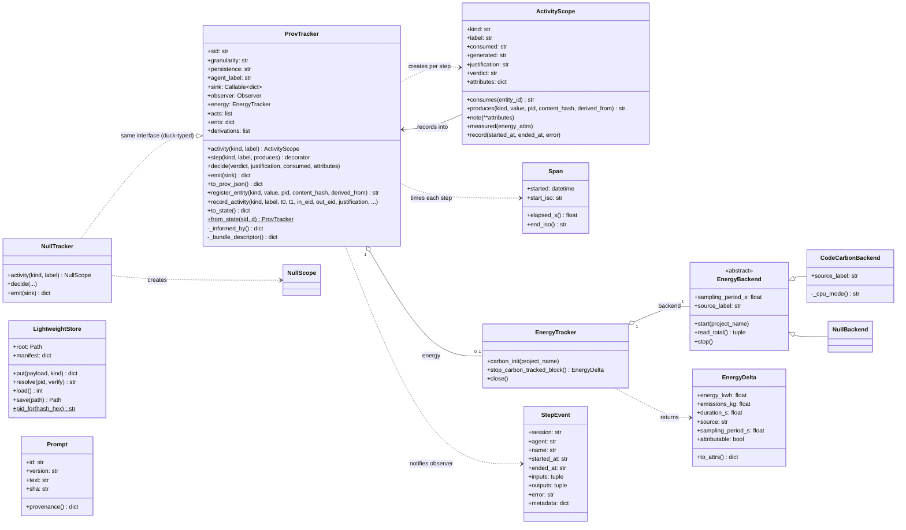
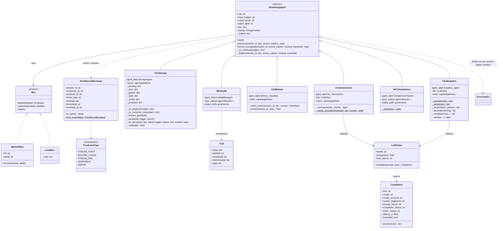
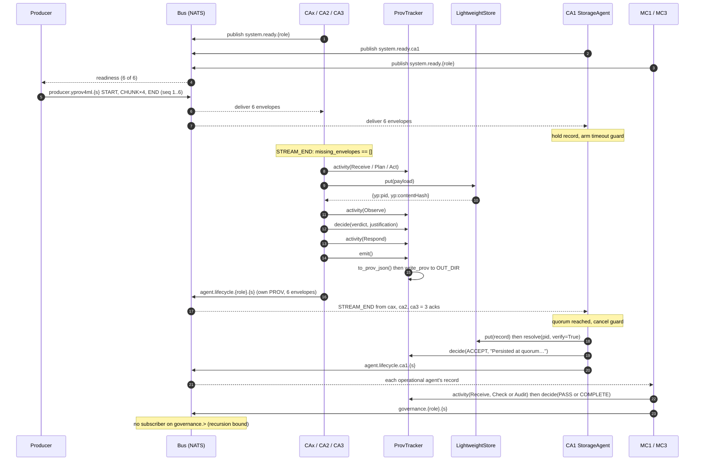
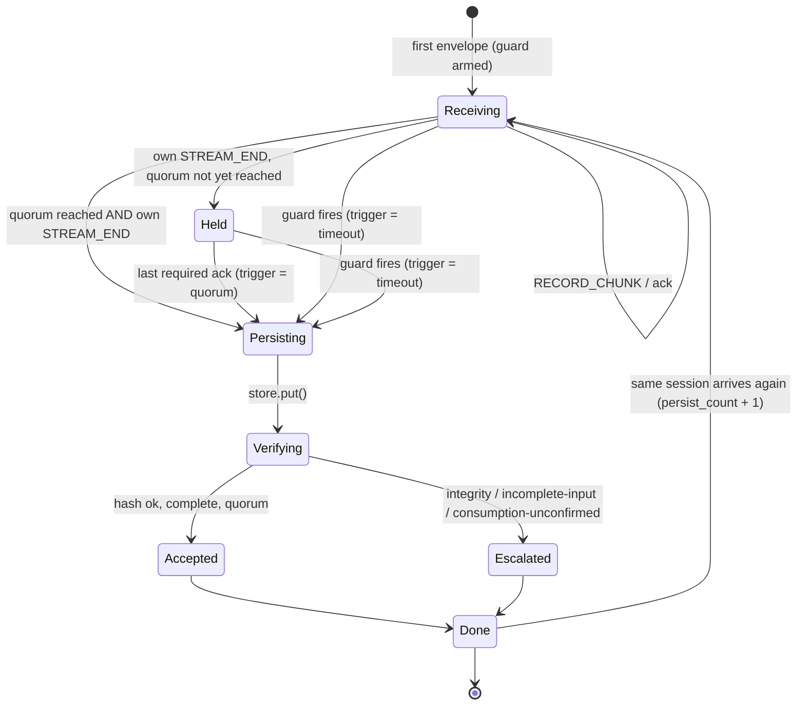
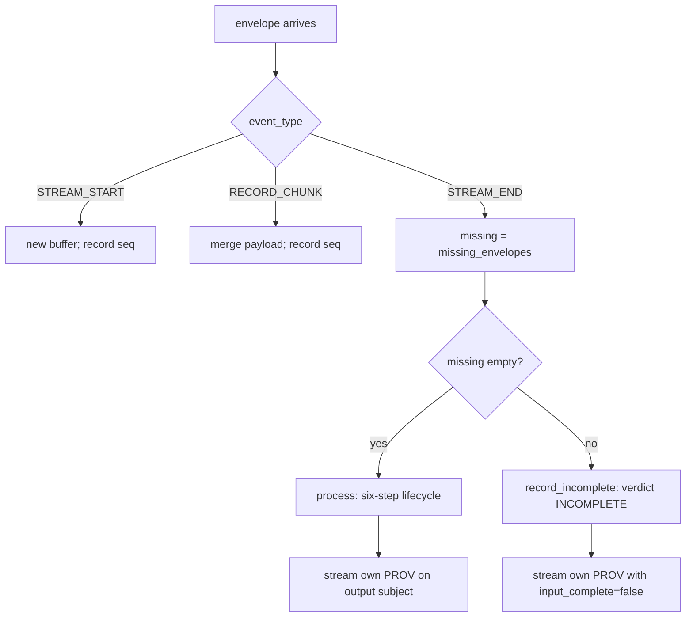
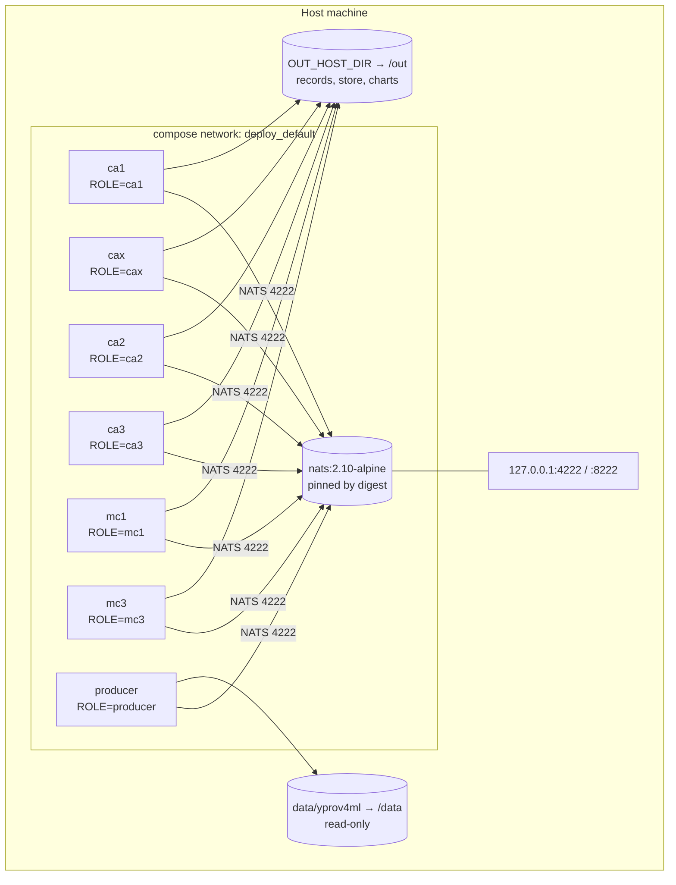
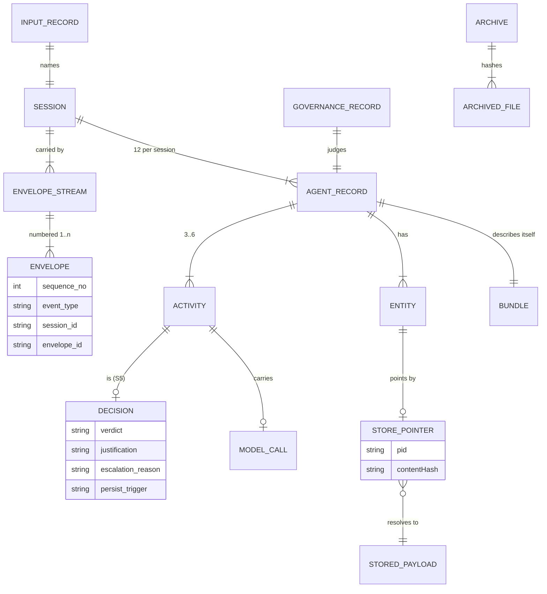

# yProv4Agents Demonstrator — System Architecture, Information Model & Ontology

**Document Version**: 1.0
**Last Updated**: 11 October 2026
**System**: Reflexive behavioural provenance for multi-agent AI (W3C PROV + `yp:` vocabulary)
**Repository state described**: branch `energy-benchmark` (stacked on `paper-audit-rewrite`);
reference evidence in `experiments/audit-reference`, `experiments/audit-llm`,
`experiments/energy-session`

> Every component, file, field and figure in this document is taken from the code or from a
> frozen archive under `experiments/`. Where a number is quoted, its archive is named beside
> it. Performance figures are machine-specific (a 4-core Windows laptop, CPython 3.11) and
> are given for orientation; the archives carry the environment they were measured in.

---

## Table of Contents

1. [System Overview](#system-overview)
2. [Phase 0: Input Records & Session Naming](#phase-0-input-records--session-naming)
3. [Phase 1: Streaming onto the Bus](#phase-1-streaming-onto-the-bus)
4. [Phase 2: Stream Reception & Completeness](#phase-2-stream-reception--completeness)
5. [Phase 3: Operational Agents — the Six-Step Lifecycle](#phase-3-operational-agents--the-six-step-lifecycle)
6. [Phase 4: Persist-After-Consume (CA1)](#phase-4-persist-after-consume-ca1)
7. [Phase 5: Record Construction & Emission](#phase-5-record-construction--emission)
8. [Phase 6: Governance — the Meta Agents](#phase-6-governance--the-meta-agents)
9. [Phase 7: Evaluation, Evidence & Continuous Integration](#phase-7-evaluation-evidence--continuous-integration)
10. [Complete System Flowchart](#complete-system-flowchart)
11. [Component Interaction Matrix](#component-interaction-matrix)
12. [Information Model](#information-model)
13. [Ontology Definition — the `yp:` Vocabulary](#ontology-definition--the-yp-vocabulary)
14. [UML Diagrams](#uml-diagrams)
15. [Data Formats & Schemas](#data-formats--schemas)
16. [Configuration Reference](#configuration-reference)
17. [System Performance Metrics](#system-performance-metrics)
18. [Key Insights](#key-insights)
19. [Troubleshooting Guide](#troubleshooting-guide)

---

## System Overview

### Architecture Style

**Event-driven, reflexive multi-agent pipeline with explicit (Strategy B) provenance capture.**

Real machine-learning provenance records are streamed onto a publish/subscribe bus. Four
*operational* agents do work on each record and emit typed W3C PROV **about themselves**;
two *meta* agents consume that self-provenance and emit PROV in turn. Every decision any
agent takes is recorded as a `yp:DecisionActivity` carrying a verdict and a
`yp:justification` written at the moment of decision — the information an external observer
cannot reconstruct ("capture, not retrieve").

```
            ┌──────────────┐   producer.yprov4ml.<session>    ┌──────────────────────┐
  yProv4ML  │   PRODUCER   │ ────────────────────────────────►│  OPERATIONAL AGENTS  │
  records ─►│  (replay)    │                                  │  CA1 CAx CA2 CA3     │
            └──────────────┘                                  └──────────┬───────────┘
                                                                         │ agent.lifecycle.<role>.<session>
                                                                         │ (each agent's OWN PROV)
                     ┌─────────────────┐                                 ▼
                     │ LightweightStore│◄── CA1 (backend API,   ┌──────────────────────┐
                     │ content-addressed│    not the bus)       │     META AGENTS      │
                     └─────────────────┘                        │     MC1  MC3         │
                                                                └──────────┬───────────┘
                                                                           │ governance.<role>.<session>
                                                                           ▼
                                                              (nothing subscribes: the
                                                               recursion stops here)
```

### Key Features

- **W3C PROV-JSON conformant**: every emitted record is accepted by the reference `prov`
  parser (24 of 24 in `experiments/audit-reference`).
- **Typed lifecycle**: six steps — Receive, Plan, Act, Observe, **Decide**, Respond — as
  `yp:` subclasses of `prov:Activity`.
- **Decision rationale as a first-class field**: `yp:justification`, refused at the call site
  if blank (`ProvTracker.decide` raises `ValueError`).
- **Reflexive**: the meta agents govern the operational agents' records and are themselves
  fully instrumented; reflexivity is bounded to one level by subject design.
- **Declared standard**: an OWL ontology (88 terms) and SHACL shapes (18 named constraints)
  under `vocab/`, applied by an independent engine (`pyshacl`).
- **Pointers, not payloads**: heavy outputs go to a content-addressed store; the record
  carries `yp:pid` + `yp:contentHash` (SHA-256).
- **Completeness-checked transport**: numbered envelopes; a gap produces an `INCOMPLETE`
  decision instead of a well-formed record of a truncated input.
- **Two transports, one behaviour**: NATS across containers, or an in-process bus; CI holds
  both to the same lineage comparison.
- **Measured, archived evidence**: every published figure comes from a hash-checked archive
  frozen from a clean commit.

### Technology Stack

| Layer | Technology |
|---|---|
| Language | Python 3.11 / 3.12 (`requires-python`), CPython |
| Package & environment | `uv` with a locked `uv.lock`, installed `--frozen` |
| Provenance model | W3C PROV-DM / PROV-JSON, built directly (no PROV library at runtime) |
| Vocabulary | OWL (`vocab/yprov4agents.ttl`), SHACL (`vocab/shapes.ttl`) |
| Validation | `prov` (reference PROV parser), `rdflib`, `pyshacl` (`eval` extra) |
| Message bus | NATS 2.10 via `nats-py` (containers), or `LocalBus` (in-process) |
| LLM (optional) | OpenAI chat completions, default `gpt-4o`, temperature 0.2, 400 max tokens |
| Charts | `matplotlib` (Agg backend) |
| Energy (optional) | `codecarbon` 3.3.1 (`energy` extra), offline tracker with a declared country |
| Containers | one image (`deploy/Dockerfile`), seven services (`deploy/docker-compose.yml`) |
| Quality gates | `ruff` (line length 96), `mypy`, `pytest` (246 tests), GitHub Actions |

### Repository Map

```
yprov4agents-demonstrator/
├── yprov4agenticai/          THE LIBRARY — framework-agnostic provenance capture
│   ├── tracker.py            ProvTracker: buffer + capture API + PROV-JSON serialiser
│   ├── api.py                ActivityScope (what a step declares), Span (two-clock timing)
│   ├── null.py               NullTracker / NullScope: provenance switched off, same interface
│   ├── observer.py           StepEvent + Layer-1 observation hook (feeds Strategy A)
│   ├── store.py              LightweightStore: content-addressed put/resolve, yp:pid
│   ├── energy.py             EnergyTracker, CodeCarbonBackend, NullBackend, EnergyDelta
│   └── prompts.py            Prompt registry: id, version, SHA of every system prompt
├── runtime/                  THE DEMONSTRATOR — agents, bus, producer
│   ├── envelope.py           ProvRecordEnvelope, ProvEventType (the wire contract)
│   ├── net_bus.py            Bus protocol, NetworkBus (NATS)
│   ├── base_agent.py         StreamingAgent, stream_document, missing_envelopes
│   ├── producer.py           replays yProv4ML records; sessions_for()
│   ├── agent_runner.py       container entrypoint; ROLE → agent class (REGISTRY)
│   ├── llm.py                LLMClient, Completion (model provenance)
│   ├── util.py               agent_tracker(), write_prov(), modes from environment
│   └── agents/               ca1_storage, cax_summariser, ca2_metrics, ca3_analytics,
│                             mc1_compliance, mc3_audit
├── run_local.py              whole pipeline in one process (LocalBus)
├── eval/                     EVALUATION — every published number is computed here
│   ├── evaluate.py           E1–E5 report (coverage, relations, shapes, verdicts)
│   ├── baseline.py           Strategy A: callback-level reconstruction; fact-level recovery
│   ├── compare.py            structural diff gate (lineage edges), --strict
│   ├── validate_shapes.py    SHACL validation via pyshacl
│   ├── fault_injection.py    nine scenarios that provoke every alternative verdict
│   ├── bench_overhead.py     E6: micro / agent / modes / scaling / pipeline timing
│   ├── bench_energy.py       E7: energy per session over interleaved windows
│   ├── bench_report.py       renders E6/E7 results; judges every difference (3× rule)
│   ├── bench_support.py      timers, dispersion (MAD), interleaving, environment capture
│   └── archive.py            freeze / verify hash-manifested experiment archives
├── vocab/                    yprov4agents.ttl (ontology), shapes.ttl (SHACL)
├── data/yprov4ml/            real yProv4ML input records (example_0, example_2)
├── experiments/              frozen archives (MANIFEST.json + files + hashes)
├── deploy/                   Dockerfile, docker-compose.yml
├── paper/                    DRAFT.md, figures.py, build_tex.py, tex/
├── docs/                     AUDIT.md, DESIGN.md, INSTRUMENTATION.md, E6_*.md, phases/
└── tests/                    246 tests, including the PROV conformance suite
```

---

## Phase 0: Input Records & Session Naming

### Overview

The system is driven by **real** yProv4ML provenance records — W3C PROV-JSON written by the
yProv4ML library during actual PyTorch training runs — rather than synthetic input. Each
input document becomes one *session*, whose name is the key every agent, subject, file and
store entry is organised by.

### Data Flow Diagram

```
┌─────────────────────────────────────────────────────────────────┐
│                   RAW DATA SOURCE                                │
│  data/yprov4ml/example_0/prov_example_GR0_0.json                 │
│  data/yprov4ml/example_2/prov_example_GR0_2.json                 │
│                                                                  │
│  Format: W3C PROV-JSON written by yProv4ML                       │
│  example_0:  9 activities / 39 entities / 55 relations           │
│  example_2: 11 activities / 78 entities / 98 relations           │
│  (plus metrics_GR0/*.csv side files, not read by the agents)     │
└────────────────────────────┬────────────────────────────────────┘
                             │
                             ▼
┌─────────────────────────────────────────────────────────────────┐
│              STEP 1: DOCUMENT DISCOVERY                          │
│  Component: _find_docs() / run_local.main()                      │
│  Files: runtime/producer.py, run_local.py                        │
│                                                                  │
│  INPUT: DATA_DIR (container: /data, local: data/yprov4ml)        │
│                                                                  │
│  PROCESSING:                                                     │
│  • Recursive glob for *.json, sorted (deterministic order)       │
│  • Parse each with json.loads; unparseable files are skipped     │
│    with a log line, never half-processed                         │
│                                                                  │
│  OUTPUT: ordered list of Paths                                   │
└────────────────────────────┬────────────────────────────────────┘
                             │
                             ▼
┌─────────────────────────────────────────────────────────────────┐
│              STEP 2: SESSION NAMING                              │
│  Component: sessions_for(paths, root)                            │
│  File: runtime/producer.py                                       │
│                                                                  │
│  RULES (one implementation, used by both replay paths):          │
│  • file directly under root        → session = file stem         │
│  • only document in its folder     → session = folder name       │
│  • several documents in one folder → session = folder__stem      │
│    (yProv4ML writes one file per GPU rank: …_GR0, …_GR1)         │
│  • characters outside [A-Za-z0-9_-] → "_"                        │
│    (a session becomes a NATS subject token; '.', '*', '>'        │
│     would split or widen the subject)                            │
│  • two documents mapping to one session → ValueError             │
│                                                                  │
│  OUTPUT:                                                         │
│  [ (…/example_0/prov_example_GR0_0.json, "example_0"),           │
│    (…/example_2/prov_example_GR0_2.json, "example_2") ]          │
└─────────────────────────────────────────────────────────────────┘
```

### Key Components

| Component | Input | Output | Purpose |
|---|---|---|---|
| **`_find_docs`** | `DATA_DIR` | sorted `.json` paths | discover input records deterministically |
| **`sessions_for`** | paths, root | `(path, session)` pairs | one unique, subject-safe session per document |

### Data Validation Rules

1. **Session format**: `[A-Za-z0-9_-]+` (e.g. `example_0`, `run7__prov_GR1`).
2. **Uniqueness**: no two input documents may share a session; collision is an error, not an
   overwrite.
3. **Input content is not validated against `yp:`**: producer records are third-party PROV
   (prefixes `prov`, `yprov`, `provml`, `dcterms`…). The agents read them as generic PROV.

---

## Phase 1: Streaming onto the Bus

### Overview

Each input document is cut into section-wise slices and published as a numbered stream of
`ProvRecordEnvelope`s: `STREAM_START → RECORD_CHUNK × n → STREAM_END`. The same emitter
(`stream_document`) is used by the producer and by every agent re-emitting its own PROV, so
there is exactly one wire format in the system.

### Data Flow Diagram

```
┌─────────────────────────────────────────────────────────────────┐
│              STEP 1: READINESS HANDSHAKE                         │
│  Component: StreamingAgent.start() / producer._wait_for_agents   │
│  Files: runtime/base_agent.py, runtime/producer.py               │
│                                                                  │
│  Each agent, on start:                                           │
│    subscribe(input_subject)                                      │
│    publish("system.ready.<role>", HEARTBEAT{role})               │
│                                                                  │
│  Producer:                                                       │
│    subscribe("system.ready.>") and wait until EXPECTED_AGENTS    │
│    (ca1,cax,ca2,ca3,mc1,mc3) have all announced — timeout 30 s,  │
│    then stream anyway and log who was missing.                   │
│                                                                  │
│  WHY: NATS core is at-most-once and not persistent; a message    │
│  published before a subscriber exists is lost.                   │
└────────────────────────────┬────────────────────────────────────┘
                             │
                             ▼
┌─────────────────────────────────────────────────────────────────┐
│              STEP 2: CHUNKING                                    │
│  Component: _chunk_document(doc)                                 │
│  File: runtime/base_agent.py                                     │
│                                                                  │
│  INPUT: one PROV-JSON document                                   │
│                                                                  │
│  PROCESSING — up to four slices, in this order:                  │
│   1. {"prefix", "agent"}            (head)                       │
│   2. {"activity"}                                                │
│   3. {"entity"}                                                  │
│   4. {used, wasGeneratedBy, wasInformedBy, wasDerivedFrom,       │
│       wasAssociatedWith, actedOnBehalfOf}   (relations)          │
│                                                                  │
│  OUTPUT: list of chunk payloads (a full record → 4 chunks)       │
└────────────────────────────┬────────────────────────────────────┘
                             │
                             ▼
┌─────────────────────────────────────────────────────────────────┐
│              STEP 3: NUMBERED STREAM EMISSION                    │
│  Component: stream_document(bus, subject, session_id, …)         │
│  File: runtime/base_agent.py                                     │
│                                                                  │
│  seq 1  STREAM_START   payload {"prefix": …}                     │
│  seq 2  RECORD_CHUNK   payload {"prefix", "agent"}               │
│  seq 3  RECORD_CHUNK   payload {"activity"}                      │
│  seq 4  RECORD_CHUNK   payload {"entity"}                        │
│  seq 5  RECORD_CHUNK   payload {relations…}                      │
│  seq 6  STREAM_END     payload end_payload (usually {})          │
│                                                                  │
│  • sequence_no runs 1..n with no gaps, so STREAM_END's own       │
│    number IS the stream length — no separate count needed        │
│  • optional delay between envelopes (STREAM_DELAY_MS: 150 in     │
│    compose, 0 locally)                                           │
│                                                                  │
│  OUTPUT: n envelopes on `subject`; returns n                     │
└────────────────────────────┬────────────────────────────────────┘
                             │
                             ▼
┌─────────────────────────────────────────────────────────────────┐
│              STEP 4: TRANSPORT                                   │
│  Component: Bus protocol                                         │
│   • NetworkBus  (runtime/net_bus.py)  — NATS, one connection     │
│     per container; publish = envelope.to_bytes() + flush         │
│   • LocalBus    (run_local.py)        — in-process; awaits each  │
│     matching handler inline, in subscription order               │
│                                                                  │
│  SUBJECTS:                                                       │
│   producer.yprov4ml.<session>        input records               │
│   agent.lifecycle.<role>.<session>   an agent's own PROV         │
│   governance.<role>.<session>        a meta agent's own PROV     │
│   system.ready.<role>                readiness heartbeat         │
│  Wildcards: '*' one token, '>' the rest                          │
└─────────────────────────────────────────────────────────────────┘
```

### Subject Routing Table

| Publisher | Subject | Subscribers |
|---|---|---|
| producer | `producer.yprov4ml.<session>` | CA1, CAx, CA2, CA3 (`producer.>`) |
| CA1, CAx, CA2, CA3 | `agent.lifecycle.<role>.<session>` | MC1, MC3 (`agent.lifecycle.>`); CA1 (acknowledgements) |
| MC1, MC3 | `governance.<role>.<session>` | **none, by design** |
| every agent | `system.ready.<role>` | producer (`system.ready.>`) |

### Key Components

| Component | Input | Output | Purpose |
|---|---|---|---|
| **`ProvRecordEnvelope`** | session, seq, producer, type, payload | JSON bytes | the single on-the-wire contract |
| **`stream_document`** | PROV-JSON document | numbered envelope stream | one emitter for producer and agents |
| **`NetworkBus`** | subject + envelope | NATS message | broker transport across containers |
| **`LocalBus`** | subject + envelope | inline handler calls | deterministic single-process transport |

---

## Phase 2: Stream Reception & Completeness

### Overview

Every agent inherits `StreamingAgent`, which reassembles each session's stream and, on
`STREAM_END`, checks that **every** numbered envelope arrived before any work is done. A
complete stream is handed to the agent's one domain method, `process()`. A stream with a gap
is not processed at all: the agent records an `INCOMPLETE` decision naming the missing
envelopes, so the loss is in the provenance rather than only in a log.

### Data Flow Diagram

```
┌─────────────────────────────────────────────────────────────────┐
│              STEP 1: BUFFER PER SESSION                          │
│  Component: StreamingAgent._on_envelope(subject, env)            │
│  File: runtime/base_agent.py                                     │
│                                                                  │
│  STREAM_START  → _buffers[sid] = {_subject, _seen:{seq}}         │
│                  merge payload                                   │
│  RECORD_CHUNK  → _seen.add(seq); merge payload section-wise      │
│  STREAM_END    → _seen.add(seq); go to STEP 2                    │
│                                                                  │
│  Merge rule (_merge_payload): dict sections are updated key by   │
│  key, so chunks may arrive split across sections                 │
└────────────────────────────┬────────────────────────────────────┘
                             │
                             ▼
┌─────────────────────────────────────────────────────────────────┐
│              STEP 2: COMPLETENESS CHECK                          │
│  Component: missing_envelopes(seen, end_sequence_no)             │
│                                                                  │
│  missing = [n for n in 1..end-1 if n not in seen]                │
│  (a sender that numbers nothing — all 0 — is reported complete   │
│   rather than entirely missing)                                  │
│                                                                  │
│        missing == []                    missing != []            │
│             │                                 │                  │
│             ▼                                 ▼                  │
│   process(sid, doc, subject)      record_incomplete(sid, …)      │
│   → (prov_json, log_line)         → ReceiveTaskActivity          │
│                                     + DecisionActivity           │
│                                       verdict INCOMPLETE         │
│                                       yp:envelopes_expected      │
│                                       yp:envelopes_missing       │
└────────────────────────────┬────────────────────────────────────┘
                             │
                             ▼
┌─────────────────────────────────────────────────────────────────┐
│              STEP 3: OFF-LOOP EXECUTION & RE-EMISSION            │
│  Component: StreamingAgent._finalize                             │
│                                                                  │
│  • process()/record_incomplete() run in the default executor     │
│    (loop.run_in_executor), so a slow model call never blocks     │
│    the subscription                                              │
│  • the agent's OWN PROV is re-emitted with stream_document on    │
│      <output_prefix>.<role>.<session>                            │
│    as session "<session>::<role>"                                │
│  • after an INCOMPLETE input, STREAM_END carries                 │
│      {"input_complete": false, "missing": [...]}                 │
│    so CA1 does not count it as a consumer acknowledgement        │
└─────────────────────────────────────────────────────────────────┘
```

### Key Components

| Component | Input | Output | Purpose |
|---|---|---|---|
| **`StreamingAgent`** | envelopes | own PROV stream | transport, buffering, completeness, re-emission — once |
| **`missing_envelopes`** | seen numbers, end number | missing numbers | detect a lossy delivery |
| **`record_incomplete`** | session, missing | `INCOMPLETE` record | record the gap instead of processing |
| **`process`** (abstract) | complete document | `(prov_json, log_line)` | the only method a concrete agent writes |

### Validation Rules

1. A document is processed **only** if envelopes `1..STREAM_END−1` all arrived.
2. An `INCOMPLETE` output is never an acknowledgement for CA1 (`input_complete: false`).
3. Domain work runs off the event loop; the bus subscription stays responsive.

---
## Phase 3: Operational Agents — the Six-Step Lifecycle

### Overview

Three operational agents (CAx, CA2, CA3) consume each producer record and do domain work on
it. Each one wraps its work in the **capture API** — `tracker.activity(...)` blocks for the
steps an observer could see, and one `tracker.decide(...)` call for the step it could not —
so the record it emits is a typed, timed, attributed six-step lifecycle. (CA1, the fourth
operational agent, follows the same lifecycle on a different trigger; see Phase 4.)

### The Lifecycle Template

```
  S1 ReceiveTaskActivity   what arrived, from where          → TaskEntity
  S2 PlanningActivity      how the work will be approached   (consumes TaskEntity)
  S3 Act                   ToolCallActivity / AnalysisActivity / PersistActivity
                                                             → ToolResult/ResponseEntity
                                                               (pid + contentHash)
  S4 ObservationActivity   check the output                  → QualityEntity
  S5 DecisionActivity ★    verdict + yp:justification        (consumes the finding or
                                                               output it judges)
  S6 ResponseActivity      hand the result on                (consumes the output)

  ★ the only step whose content no external observer can reconstruct
  Meta agents use a declared subset: S1, S3 (governance activity), S5.
```

### Data Flow Diagram — CAx NL_Summarizer

```
┌─────────────────────────────────────────────────────────────────┐
│  CAx  NL_Summarizer          runtime/agents/cax_summariser.py    │
│  input: producer.>   output: agent.lifecycle.cax.<session>       │
├─────────────────────────────────────────────────────────────────┤
│  S1 Receive   counts = prov_counts(doc)                          │
│               → TaskEntity "producer doc on <subject>"           │
│  S2 Plan      scoping is a no-op here, and the record says so    │
│               (the activity takes no measurable time)            │
│  S3 ToolCall  _summarise():                                      │
│                 model path:  llm.complete(ACT_SYSTEM, facts)     │
│                   facts = counts + first 6 activity names        │
│                 computed path (no key, or call failed):          │
│                   deterministic template sentence                │
│               store.put(summary, kind="summary") → yp:pid        │
│               → ResponseEntity (pid, contentHash,                │
│                                 derived_from TaskEntity)         │
│               note yp:summary_mode = llm | computed |            │
│                                     computed-after-<Error>       │
│               note Completion.provenance() (model path only):    │
│                 yp:model, yp:model_resolved,                     │
│                 yp:system_fingerprint, yp:temperature,           │
│                 yp:max_tokens, yp:prompt_id/_version/_sha,       │
│                 yp:prompt_tokens, yp:completion_tokens,          │
│                 yp:finish_reason, yp:llm_latency_s,              │
│                 yp:response_sha                                  │
│  S4 Observe   _check_grounding(): every numeral ≥ 10 in the      │
│               summary must equal a count from the graph          │
│               → QualityEntity "<n> ungrounded figure(s)"         │
│               note yp:grounding_check, yp:ungrounded_figure_count│
│  S5 Decide    ACCEPT  if grounded and not truncated              │
│               REVISE  otherwise                                  │
│               justification: summary length, path, graph size,   │
│               what the grounding check established, truncation   │
│  S6 Respond   consumes the ResponseEntity                        │
└─────────────────────────────────────────────────────────────────┘
```

### Data Flow Diagram — CA2 Metrics_Visualizer

```
┌─────────────────────────────────────────────────────────────────┐
│  CA2  Metrics_Visualizer       runtime/agents/ca2_metrics.py     │
│  deterministic, no model                                         │
├─────────────────────────────────────────────────────────────────┤
│  S1 Receive   → TaskEntity                                       │
│  S2 Plan      _select_series(): numeric prov:value entities      │
│               (≤10 series) → ChartSpec(subject=numeric-metrics)  │
│               none found   → ChartSpec(subject=graph-composition)│
│  S3 ToolCall  matplotlib (Agg) renders OUT_DIR/charts/           │
│               <session>_metrics.png; the store records the PNG's │
│               path (kind="chart") → ToolResultEntity (pid, hash) │
│  S4 Observe   confirm the file exists and is non-empty           │
│               note yp:rendered_bytes                             │
│  S5 Decide    ACCEPT  if rendered_bytes > 0 and subject is       │
│                       numeric-metrics                            │
│               REVISE  otherwise (a valid chart of the record's   │
│                       shape, not of the run's measurements)      │
│               attributes yp:chart_subject, yp:series_plotted     │
│  S6 Respond                                                      │
└─────────────────────────────────────────────────────────────────┘
```

### Data Flow Diagram — CA3 Analytics_Agent

```
┌─────────────────────────────────────────────────────────────────┐
│  CA3  Analytics_Agent          runtime/agents/ca3_analytics.py   │
│  heuristic core; a model, if present, only narrates              │
├─────────────────────────────────────────────────────────────────┤
│  S1 Receive   → TaskEntity "provenance graph from <subject>"     │
│  S2 Plan      note yp:algorithms =                               │
│               structure,timing,sustainability,resource,anomaly   │
│  S3 Analysis  A1 structure  composition, typing coverage,        │
│                             derivations, terminal entities       │
│               A2 timing     start-ordered activities, gaps,      │
│                             wall clock (tolerates               │
│                             "...^^xsd:dateTime"; normalises TZ)  │
│               A3 sustain.   energy/emission streams by label     │
│                             (emission|energy|carbon|power)       │
│               A4 resource   cpu|gpu|ram|memory|disk|temp|usage,  │
│                             excluding the energy family          │
│               A5 anomaly    a gap is an anomaly only if          │
│                             > 3.5 MAD above the median, with ≥5  │
│                             gaps, ≥ 5% of wall clock and ≥ 0.5 s │
│               completeness  unclosed activities, partial typing, │
│                             missing streams — reported APART     │
│                             from anomalies                       │
│               report → store (kind="analytics-report")           │
│               → ToolResultEntity; notes yp:activities_analysed,  │
│                 yp:entities_analysed, yp:energy_streams,         │
│                 yp:resource_streams, yp:wall_clock_s,            │
│                 yp:report_mode                                   │
│  S4 Observe   → QualityEntity "<a> invariant(s) breached,        │
│                                <c> completeness gap(s)"          │
│  S5 Decide    ANOMALY if any invariant breached, else OK         │
│               attributes yp:anomaly_count,                       │
│                          yp:completeness_gap_count               │
│  S6 Respond                                                      │
└─────────────────────────────────────────────────────────────────┘
```

### Agent Summary

| Role | Class | `prov:label` | Act step | Verdicts | Model |
|---|---|---|---|---|---|
| CA1 | `CA1Storage` | StorageAgent | `PersistActivity` | ACCEPT / ESCALATE | — |
| CAx | `CAxSummariser` | NL_Summarizer | `ToolCallActivity` | ACCEPT / REVISE | optional, writes the summary |
| CA2 | `CA2Metrics` | Metrics_Visualizer | `ToolCallActivity` | ACCEPT / REVISE | — |
| CA3 | `CA3Analytics` | Analytics_Agent | `AnalysisActivity` | OK / ANOMALY | optional, narrates only |
| MC1 | `MC1Compliance` | ComplianceChecker | `ComplianceCheckActivity` | PASS / FAIL | — |
| MC3 | `MC3Audit` | AuditabilityAgent | `AuditActivity` | COMPLETE / PARTIAL | — |
| any streaming agent but CA1 | (base class) | — | — | INCOMPLETE | — |

### What the Reference Run Decided (`experiments/audit-reference`)

| Agent:verdict | Count | Why |
|---|--:|---|
| `ca1:ACCEPT` | 2 | both records persisted at quorum, integrity verified |
| `cax:ACCEPT` | 2 | computed summaries, every figure ≥ 10 grounded |
| `ca2:REVISE` | 2 | the real records carry no numeric `prov:value` → composition chart |
| `ca3:ANOMALY` | 2 | timing gaps of 5.0 s / 102.9 s breach the MAD invariant |
| `mc1:PASS` | 8 | every operational record meets the structural standard |
| `mc3:COMPLETE` | 8 | every operational lifecycle is ordered and timed |

---

## Phase 4: Persist-After-Consume (CA1)

### Overview

CA1 archives each producer record **only after its consumers have used it**, and writes it
through the store's own API, not onto the bus — the bus carries a receipt (a `yp:pid` and a
content hash), never the payload. It holds the record, counts acknowledgements from the
consumers named in `PERSIST_AFTER` (default `cax,ca2,ca3`), persists at quorum, and keeps a
timeout guard so a crashed consumer cannot lose a record. Its decision states which path was
taken and, on escalation, why.

### Data Flow Diagram

```
┌─────────────────────────────────────────────────────────────────┐
│              STEP 1: HOLD THE RECORD                             │
│  Component: CA1Storage._on_producer          (producer.>)        │
│  File: runtime/agents/ca1_storage.py                             │
│                                                                  │
│  • reassemble the producer stream into _pending[sid]             │
│  • _seen[sid] += seq; at STREAM_END _ended[sid] = seq            │
│  • ARM the timeout guard on the FIRST envelope (not the last:    │
│    a lost STREAM_END would otherwise leave nothing to fire)      │
│  • a session seen before is held again, not ignored              │
└────────────────────────────┬────────────────────────────────────┘
                             │
                             ▼
┌─────────────────────────────────────────────────────────────────┐
│              STEP 2: COUNT ACKNOWLEDGEMENTS                      │
│  Component: CA1Storage._on_consumer_ack   (agent.lifecycle.>)    │
│                                                                  │
│  an ack = STREAM_END on agent.lifecycle.<role>.<sid>,            │
│           role ≠ ca1, sid pending,                               │
│           payload.input_complete is not False                    │
│                                                                  │
│  quorum = PERSIST_AFTER ⊆ acks[sid]                              │
│    and CA1's own copy has ended (else wait for its STREAM_END;   │
│    persisting earlier would store a partial copy)                │
│                                                                  │
│         quorum reached ───────► cancel guard ─► STEP 3 (quorum)  │
│         guard fires (PERSIST_TIMEOUT_S, 25 s in compose)         │
│                       ───────────────────────► STEP 3 (timeout)  │
└────────────────────────────┬────────────────────────────────────┘
                             │
                             ▼
┌─────────────────────────────────────────────────────────────────┐
│              STEP 3: PERSIST, WITH ITS OWN LIFECYCLE             │
│  Component: CA1Storage._do_persist  (run in the executor)        │
│                                                                  │
│  S1 Receive   counts; → TaskEntity "record '<sid>' held"         │
│  S2 Plan      yp:persist_policy=after-consume,                   │
│               yp:required_consumers, yp:acknowledged_by          │
│  S3 Persist   payload = json.dumps(doc, sort_keys=True)          │
│               pointer = store.put(payload,                       │
│                                   kind="provenance-record")      │
│               → ToolResultEntity (pid, contentHash);             │
│                 yp:store, yp:size_bytes                          │
│  S4 Observe   store.resolve(pid, verify=True) — a real read of   │
│               the file and a re-hash; store.save() refreshes the │
│               manifest                                           │
│  S5 Decide    first failing condition wins:                      │
│                 integrity broken      → ESCALATE  "integrity"    │
│                 envelopes missing     → ESCALATE                 │
│                                         "incomplete-input"       │
│                 persisted by timeout  → ESCALATE                 │
│                                       "consumption-unconfirmed"  │
│                 otherwise             → ACCEPT                   │
│               attributes yp:persist_trigger (quorum|timeout),    │
│                 yp:consumers_required, yp:consumers_acknowledged,│
│                 [yp:escalation_reason], [yp:envelopes_missing],  │
│                 [yp:persist_count when > 1]                      │
│  S6 Respond   → ResponseEntity "storage receipt <pid> (sha…)"    │
│                                                                  │
│  then: stream_document on agent.lifecycle.ca1.<sid>              │
└─────────────────────────────────────────────────────────────────┘
```

### The Three Escalations

| `yp:escalation_reason` | Condition | Operator response it calls for | Observed in |
|---|---|---|---|
| `integrity` | stored bytes do not re-hash to the pointer | storage is corrupting records — stop writes | `faults/ca1-integrity` |
| `incomplete-input` | CA1's copy of the record lost envelopes | transport loss — re-send the record | `faults/ca1-incomplete` |
| `consumption-unconfirmed` | archived by the timeout, not at quorum | a consumer is down — restart it | `faults/ca1-timeout` |

A callback-level observer recovers the verdict (ESCALATE) for all three and the reason for
none of them (paper §6.2, Figure 2).

### Key Components

| Component | Input | Output | Purpose |
|---|---|---|---|
| **`_on_producer`** | producer envelopes | held record, armed guard | hold until consumed |
| **`_on_consumer_ack`** | consumers' STREAM_END | acknowledgement set | decide when quorum holds |
| **`_timeout_guard`** | elapsed time | persist (timeout) | never silently drop a record |
| **`_do_persist`** | record, acks, trigger | CA1's PROV, receipt | store, verify, decide, report |
| **`LightweightStore`** | payload string | `{yp:pid, yp:contentHash}` | content-addressed persistence |

---

## Phase 5: Record Construction & Emission

### Overview

Every agent builds its record with one `ProvTracker` (or a `NullTracker` when provenance is
switched off), created by `runtime.util.agent_tracker()` so that the run's mode flags are
honoured by every agent or none. The tracker accumulates activities and entities as the
agent works and serialises them to PROV-JSON on `emit()`, which hands the document to a sink
that writes it to the output volume.

### Data Flow Diagram

```
┌─────────────────────────────────────────────────────────────────┐
│              STEP 1: CONSTRUCT THE TRACKER                       │
│  Component: agent_tracker(role, session, agent_label, sid,       │
│                           energy)                                │
│  File: runtime/util.py                                           │
│                                                                  │
│  prov_mode() from the environment:                               │
│   PROV_GRANULARITY      DATA (default) | METADATA                │
│   PROV_PERSISTENCE      PERSISTENT (default) | TRANSIENT         │
│   PROV_INSTRUMENTATION  on (default) | off → NullTracker         │
│  energy_tracker():                                               │
│   PROV_ENERGY           off (default) | null | codecarbon        │
│   PROV_ENERGY_COUNTRY   3-letter ISO code (no network lookup)    │
│  sink = partial(write_prov, role, session)                       │
└────────────────────────────┬────────────────────────────────────┘
                             │
                             ▼
┌─────────────────────────────────────────────────────────────────┐
│              STEP 2: CAPTURE — per step                          │
│  Component: ProvTracker.activity() / decide()                    │
│  Files: yprov4agenticai/tracker.py, yprov4agenticai/api.py       │
│                                                                  │
│  with tracker.activity(kind, label) as prov:     ┐ automatic:    │
│      prov.consumes(entity_id)        → used      │ type, label,  │
│      prov.produces(kind, value,      → entity +  │ start instant,│
│          pid=, content_hash=,          wasGener- │ measured      │
│          derived_from=)                atedBy +  │ duration,     │
│                                        wasDeriv- │ attribution,  │
│                                        edFrom    │ order, failure│
│      prov.note(**attrs)              → yp: attrs ┘ (yp:outcome)  │
│                                                                  │
│  tracker.decide(verdict, justification, consumed=, attributes=)  │
│      → yp:DecisionActivity with yp:verdict, yp:justification     │
│      → raises ValueError if the justification is blank           │
│                                                                  │
│  Span: start = wall clock (comparable across processes);         │
│        end   = start + perf_counter() elapsed (resolves sub-ms   │
│        steps the 15.6 ms Windows wall clock cannot)              │
│  Energy (if enabled): delta since the previous step boundary,    │
│        with yp:energy_source, yp:energy_sampling_period_s,       │
│        yp:energy_attributable                                    │
│  Observer (if installed): a StepEvent per step — name, times,    │
│        inputs, outputs, error; never verdict or justification    │
└────────────────────────────┬────────────────────────────────────┘
                             │
                             ▼
┌─────────────────────────────────────────────────────────────────┐
│              STEP 3: SERIALISE                                   │
│  Component: ProvTracker.to_prov_json()                           │
│                                                                  │
│  prefix   yp, prov, xsd                                          │
│  agent    yp:agent_<sid>  (yp:OperationalAgent, prov:label)      │
│  activity yp:<Kind>_<sid>_<nn>  with prov:type, label,           │
│           startTime, endTime, [yp:justification, yp:verdict,     │
│           yp:* notes, energy attrs]                              │
│  entity   yp:bundle_<sid> (prov:Bundle: granularity,             │
│           persistence, emitted_by, library_version)              │
│           + yp:<Kind>_<sid> data entities (DATA mode only)       │
│  wasDerivedFrom     declared only — never inferred               │
│  wasAssociatedWith  one per activity                             │
│  wasInformedBy      DERIVED: a2 used what a1 generated           │
│  used, wasGeneratedBy   (DATA mode only)                         │
│                                                                  │
│  METADATA mode: no data entities and no entity relations;        │
│  activities, justifications, association and informedBy remain  │
└────────────────────────────┬────────────────────────────────────┘
                             │
                             ▼
┌─────────────────────────────────────────────────────────────────┐
│              STEP 4: EMIT                                        │
│  Component: ProvTracker.emit() → write_prov(role, session, doc)  │
│                                                                  │
│  TRANSIENT  → return the document, do not call the sink          │
│  PERSISTENT → sink(doc):                                         │
│     OUT_DIR/<safe session>__<role>_prov.json                     │
│     never overwrites: a repeat becomes …__<role>__2_prov.json    │
│     (exclusive create, one attempt per write)                    │
│  The returned document is ALSO re-emitted on the bus by the      │
│  agent (Phase 2, step 3), whatever the persistence mode          │
└─────────────────────────────────────────────────────────────────┘
```

### Identifier Scheme

| Node | Identifier pattern | Example |
|---|---|---|
| agent | `yp:agent_<sid>` | `yp:agent_example_0` |
| activity | `yp:<Kind>_<sid>_<nn>` (nn = order, 2 digits) | `yp:DecisionActivity_example_0_04` |
| entity | `yp:<Kind>_<sid>[suffix]` | `yp:ToolResultEntity_example_0` |
| bundle | `yp:bundle_<sid>` | `yp:bundle_example_0` |
| meta agent sid | `<session>-mc1`, `<session>-mc3` | `example_0::cax-mc1` |
| relation | blank node per kind: `_:a<i>`, `_:u<i>`, `_:g<i>`, `_:i<i>`, `_:d<i>` | `_:i3` |
| store pointer | `21.T11999/yprovstore-<first 12 hex of sha256>` | `21.T11999/yprovstore-5a890fa6b6f3` |

### Instrumentation Modes

| Mode | Built | Written | Entities | Use |
|---|---|---|---|---|
| DATA + PERSISTENT (default) | yes | yes | yes | normal operation |
| METADATA | yes | yes | bundle only | −37.6% bytes, every justification kept |
| TRANSIENT | yes | no (still published on the bus) | yes | isolate build cost; in-memory use |
| `PROV_INSTRUMENTATION=off` | no (`NullTracker`) | no | — | overhead baseline (condition OFF) |

---

## Phase 6: Governance — the Meta Agents

### Overview

MC1 and MC3 subscribe to `agent.lifecycle.>` — the operational agents' **own** provenance —
and judge it. They publish to `governance.<role>.<session>`, a prefix nothing subscribes to,
so the governance layer cannot re-trigger itself: reflexivity in a run is exactly one level
deep, by construction rather than by a counter. Both meta agents are fully instrumented and
satisfy the standard they enforce.

### Data Flow Diagram

```
┌─────────────────────────────────────────────────────────────────┐
│  MC1  ComplianceChecker        runtime/agents/mc1_compliance.py  │
│  input: agent.lifecycle.>   output: governance.mc1.<session>     │
├─────────────────────────────────────────────────────────────────┤
│  S1 Receive          → TaskEntity "<role> PROV under review"     │
│  S3 ComplianceCheck  _check(doc) applies four named checks:      │
│     namespace-declarations  prov and yp bound to the right URIs  │
│     typed-activities        every activity's prov:type is one of │
│                             the 11 lifecycle classes             │
│                             (yp:TypedActivityShape)              │
│     decision-present        ≥1 yp:DecisionActivity               │
│                             (yp:AgentDecidedShape)               │
│     decision-justified      every decision's justification is    │
│                             non-blank, typed literals included   │
│                             (yp:DecisionShape)                   │
│     → QualityEntity "<n> structural failure(s)"                  │
│     notes yp:target_agent, yp:checks_applied,                    │
│           yp:standard = vocab/shapes.ttl,                        │
│           yp:activities_examined, yp:decisions_examined          │
│  S5 Decide           PASS if no failures, else FAIL              │
└─────────────────────────────────────────────────────────────────┘

┌─────────────────────────────────────────────────────────────────┐
│  MC3  AuditabilityAgent        runtime/agents/mc3_audit.py       │
├─────────────────────────────────────────────────────────────────┤
│  S1 Receive   → TaskEntity "<agent> PROV under audit"            │
│  S3 Audit     _reconstruct(doc) → Trail: steps ordered by        │
│               prov:startTime, justified count, activities with   │
│               no start (unordered), no end (unterminated)        │
│               → QualityEntity "agent=…; steps=…; trail=…"        │
│               notes yp:audited_agent, yp:step_count,             │
│                     yp:justified_step_count,                     │
│                     yp:orderable_step_count                      │
│  S5 Decide    COMPLETE if every step is ordered and timed,       │
│               PARTIAL otherwise (names the gaps)                 │
└─────────────────────────────────────────────────────────────────┘
```

### The Reflexivity Bound

```
   producer.>  ──►  CA1 CAx CA2 CA3  ──►  agent.lifecycle.>  ──►  MC1 MC3  ──►  governance.>
   (level 0)        (operational)         (level 1: governed)     (meta)        (level 2:
                                                                                 NOT governed —
                                                                                 no subscriber)
```

Within that bound, MC1 has been applied offline to its own output and to MC3's, and both
pass: the checker satisfies the rule it enforces on everyone else.

### Agreement with the Declared Standard

MC1 is a second implementation of the standard in `vocab/shapes.ttl`, and is tested against
it (`tests/test_shapes.py::test_the_shapes_and_the_compliance_agent_agree`) over eight
mutations of a conforming record. One difference is deliberate and pinned by its own test:
MC1 requires a decision to *state* `prov:type yp:DecisionActivity`, while the shapes, under
RDFS inference, infer it from `yp:justification`'s domain.

---

## Phase 7: Evaluation, Evidence & Continuous Integration

### Overview

Nothing the paper reports is typed in by hand. A run is reduced to tables by `eval/`, judged
by independent implementations where the claim concerns a standard, compared structurally
against a frozen reference, and archived with per-file hashes and the commit it came from.

### Data Flow Diagram

```
┌─────────────────────────────────────────────────────────────────┐
│  RUN            python run_local.py --out-dir out --baseline     │
│                 (or docker compose … up — the distributed path)  │
│  OUTPUT         out/*_prov.json (24), out/store/, out/charts/,   │
│                 out/baseline/_events.json + Strategy A PROV      │
└────────────────────────────┬────────────────────────────────────┘
                             │
         ┌───────────────────┼───────────────────┬─────────────────────┐
         ▼                   ▼                   ▼                     ▼
┌─────────────────┐ ┌─────────────────┐ ┌─────────────────┐ ┌──────────────────┐
│ eval.evaluate   │ │ eval.baseline   │ │ eval.compare    │ │ eval.validate_   │
│ E1 coverage     │ │ Strategy A vs B │ │ --before        │ │ shapes           │
│ E1b relation    │ │ (same run)      │ │ experiments/    │ │ pyshacl over RDF │
│   provenance    │ │ verbatim search │ │ audit-reference │ │ from the `prov`  │
│ E2 justification│ │ + fact-level    │ │ --strict:       │ │ library, with    │
│   coverage,     │ │ recovery (E3b)  │ │ lineage EDGES,  │ │ RDFS inference   │
│   bytes share   │ │                 │ │ not counts      │ │ over the ontology│
│ E4 reflexivity  │ │                 │ │ exit 1 on any   │ │ 24/24 conform    │
│ E5 verdicts     │ │                 │ │ undeclared diff │ │                  │
└─────────────────┘ └─────────────────┘ └─────────────────┘ └──────────────────┘
         │                   │                   │                     │
         └───────────────────┴─────────┬─────────┴─────────────────────┘
                                       ▼
┌─────────────────────────────────────────────────────────────────┐
│  FAULT INJECTION   python -m eval.fault_injection --all          │
│  nine scenarios; the fault goes into the input or environment,   │
│  never into the check being tested:                              │
│   ca1-integrity    ESCALATE  integrity                           │
│   ca1-timeout      ESCALATE  consumption-unconfirmed             │
│   ca1-incomplete   ESCALATE  incomplete-input                    │
│   stream-gap       INCOMPLETE (CAx; envelope 3 of 6 withheld)    │
│   mc1-unjustified  FAIL      (a third-party record)              │
│   mc3-untimed      PARTIAL   (an activity never closed)          │
│   ca2-accept       ACCEPT    (a record that carries metrics)     │
│   cax-revise       REVISE    (a scripted model reply with an     │
│                               invented figure)                   │
│   ca3-ok           OK        (regular timing, fully typed)       │
│  → all 13 verdicts observed                                      │
└────────────────────────────┬────────────────────────────────────┘
                             ▼
┌─────────────────────────────────────────────────────────────────┐
│  BENCHMARKS                                                      │
│  eval.bench_overhead  E6: micro (per call), agent (OFF/A/B-TRANS │
│                       /B, 30 interleaved reps), modes, scaling   │
│                       (10…10,000 activities), pipeline           │
│  eval.bench_energy    E7: 12 rounds of whole-session windows +   │
│                       IDLE, CPU (measured) and RAM (modelled)    │
│  eval.bench_report    renders both; a difference is a result     │
│                       only at ≥ 3× the larger MAD dispersion     │
└────────────────────────────┬────────────────────────────────────┘
                             ▼
┌─────────────────────────────────────────────────────────────────┐
│  ARCHIVE   python -m eval.archive freeze --name <n>              │
│                    --source out/… --require-clean                │
│  • reads git state BEFORE copying; refuses a dirty tree          │
│  • MANIFEST.json (schema yprov4agents/experiment-manifest/2):    │
│    commit, branch, describe, dirty, changes, environment, every  │
│    file's size and sha256; GIT_DIFF.patch if dirty               │
│  • eval.archive verify --name <n> re-hashes every file           │
└─────────────────────────────────────────────────────────────────┘
```

### Continuous Integration (`.github/workflows/ci.yml`)

| Job | What it runs | Fails when |
|---|---|---|
| Lint and format | `ruff check`, `ruff format --check` | any style or lint finding |
| Type check (3.11, 3.12) | `mypy yprov4agenticai runtime eval tests run_local.py` | any type error |
| Tests (Linux/Windows × 3.11/3.12) | `pytest` with coverage; `eval.archive verify` for every archive | a test fails or an archive no longer matches its manifest |
| End-to-end pipeline | `run_local.py --baseline` → evaluate → baseline test → `compare --strict` vs `audit-reference` → fault injection → conformance suite → shapes | any lineage edge changes undeclared, a verdict becomes unreachable, a record stops conforming |
| Distributed pipeline | `docker compose up` (NATS + 6 agents + producer), wait for 24 records → `compare --strict` → shapes | the container path diverges from the reference |
| Container image | build the image; import every role's agent class | the image cannot run an agent it claims to contain |

Every action is pinned to a commit SHA and the base images to a digest.

---
## Complete System Flowchart

### High-Level End-to-End Flow

```
                         ┌───────────────────────────────┐
                         │  yProv4ML PROV-JSON records    │
                         │  data/yprov4ml/**/*.json       │
                         └───────────────┬───────────────┘
                                         │ sessions_for()
                                         ▼
                         ┌───────────────────────────────┐
                         │  PRODUCER                      │
                         │  wait for system.ready.* (6)   │
                         │  stream_document() per record  │
                         └───────────────┬───────────────┘
                                         │ producer.yprov4ml.<session>
                                         │ START · CHUNK×4 · END  (seq 1..6)
             ┌──────────────┬────────────┼─────────────┬──────────────┐
             ▼              ▼            ▼             ▼              │
      ┌────────────┐ ┌────────────┐ ┌────────────┐ ┌────────────┐     │
      │ CAx        │ │ CA2        │ │ CA3        │ │ CA1        │     │
      │ summarise  │ │ chart      │ │ analyse    │ │ HOLD       │     │
      │ (LLM opt.) │ │            │ │            │ │ + guard    │     │
      └─────┬──────┘ └─────┬──────┘ └─────┬──────┘ └─────▲──────┘     │
            │ complete?    │              │              │ acks       │
            │ else         │              │              │ (STREAM_END│
            │ INCOMPLETE   │              │              │  from cax, │
            ▼              ▼              ▼              │  ca2, ca3) │
      ┌──────────────────────────────────────────┐       │            │
      │ agent.lifecycle.<role>.<session>         │───────┘            │
      │ each agent's OWN six-step PROV           │                    │
      └──────────────────────┬───────────────────┘                    │
                             │                       quorum or timeout│
                             │                    ┌────────────────────┘
                             │                    ▼
                             │            ┌────────────────┐   store.put / resolve
                             │            │ CA1 persist,   │◄─────────────────────►┌──────────┐
                             │            │ verify, decide │                        │  STORE   │
                             │            └───────┬────────┘                        │ yp:pid   │
                             │                    │ agent.lifecycle.ca1.<session>   └──────────┘
                             ▼                    ▼
                  ┌──────────────────────────────────────┐
                  │ MC1 compliance      MC3 audit         │
                  │ (each record of each operational      │
                  │  agent → 2 × 4 × sessions records)    │
                  └──────────────────┬───────────────────┘
                                     │ governance.<role>.<session>
                                     ▼
                         ┌───────────────────────────────┐
                         │ OUT_DIR                        │
                         │ 24 *_prov.json per 2 records:  │
                         │   8 operational + 16 meta      │
                         │ store/  charts/  [baseline/]   │
                         └───────────────┬───────────────┘
                                         ▼
                         ┌───────────────────────────────┐
                         │ eval: evaluate · baseline ·    │
                         │ compare · shapes · faults ·    │
                         │ benchmarks · archive           │
                         └───────────────────────────────┘
```

### Detailed Component Interaction Flowchart (one record, one consumer)

```
 Producer        Bus            CAx (StreamingAgent)        ProvTracker        Store      CA1          MC1
    │             │                     │                        │               │         │            │
    │ publish ×6  │                     │                        │               │         │            │
    │────────────►│  deliver ×6         │                        │               │         │            │
    │             │────────────────────►│ buffer, _seen          │               │         │ hold, guard│
    │             │──────────────────────────────────────────────────────────────────────►│            │
    │             │                     │ STREAM_END: missing=[] │               │         │            │
    │             │                     │ process() in executor  │               │         │            │
    │             │                     │── activity(Receive) ──►│               │         │            │
    │             │                     │── activity(Plan) ─────►│               │         │            │
    │             │                     │── activity(ToolCall) ─►│               │         │            │
    │             │                     │        put(summary) ───────────────────►│         │            │
    │             │                     │        ◄──────── {yp:pid, contentHash} ─│         │            │
    │             │                     │── activity(Observe) ──►│               │         │            │
    │             │                     │── decide(ACCEPT, why) ►│               │         │            │
    │             │                     │── activity(Respond) ──►│               │         │            │
    │             │                     │── emit() ─────────────►│ to_prov_json  │         │            │
    │             │                     │                        │ write_prov ──► OUT_DIR  │            │
    │             │  agent.lifecycle.cax.<s>  START·CHUNK×4·END  │               │         │            │
    │             │◄────────────────────│                        │               │         │            │
    │             │─────────────────────────────────────────────────────────────►│ ack cax │            │
    │             │──────────────────────────────────────────────────────────────────────────────────►│
    │             │                     │                        │               │         │  _check()  │
    │             │                     │                        │               │         │  decide    │
    │             │  governance.mc1.<s>                                                    │  PASS      │
    │             │◄───────────────────────────────────────────────────────────────────────────────────│
    │             │  (no subscriber)                                                       │            │
```

---

## Component Interaction Matrix

| Component | Receives From | Sends To | Data Format | Processing Type |
|---|---|---|---|---|
| **producer** (`runtime/producer.py`) | `data/yprov4ml` files; `system.ready.*` | bus `producer.yprov4ml.*` | `ProvRecordEnvelope` stream | file replay |
| **NetworkBus / LocalBus** | any publisher | subscribers by subject pattern | envelope bytes / objects | transport |
| **StreamingAgent** (base) | bus | agent `process()`; bus | merged PROV-JSON dict | buffering, completeness check |
| **CAx** NL_Summarizer | `producer.>` | store; bus `agent.lifecycle.cax.*`; `OUT_DIR` | PROV-JSON + summary text | LLM (optional) + rule-based check |
| **CA2** Metrics_Visualizer | `producer.>` | `charts/`; store; bus; `OUT_DIR` | PROV-JSON + PNG | deterministic rendering |
| **CA3** Analytics_Agent | `producer.>` | store; bus; `OUT_DIR` | PROV-JSON + report text | heuristic mining (+ LLM narration) |
| **CA1** StorageAgent | `producer.>`, `agent.lifecycle.>` | store; bus `agent.lifecycle.ca1.*`; `OUT_DIR` | PROV-JSON + stored record | stateful coordination |
| **MC1** ComplianceChecker | `agent.lifecycle.>` | bus `governance.mc1.*`; `OUT_DIR` | PROV-JSON | rule-based (shape subset) |
| **MC3** AuditabilityAgent | `agent.lifecycle.>` | bus `governance.mc3.*`; `OUT_DIR` | PROV-JSON | rule-based reconstruction |
| **ProvTracker** | the agent's capture calls | sink (`write_prov`); caller | in-memory lists → PROV-JSON | record construction |
| **LightweightStore** | agents' `put` | agents' `resolve`; disk | payload ↔ `{yp:pid, yp:contentHash}` | content addressing |
| **LLMClient** | CAx, CA3 | OpenAI API | `Prompt` + facts → `Completion` | remote model call |
| **EnergyTracker** | tracker step boundaries | tracker | `EnergyDelta` → `yp:energy_*` | sampling backend |
| **Observer / CallbackLogger** | tracker step boundaries | `out/baseline/` | `StepEvent` → Strategy A PROV | Layer-1 reconstruction |
| **eval.*** | `out/`, `experiments/` | reports, archives, exit codes | Markdown, JSON, manifests | measurement & gating |

---

## Information Model

### Purpose and Scope

The information model names every kind of information the system creates, moves or keeps,
independent of how it is serialised. Section 13 maps the provenance part of it onto the
`yp:` ontology; Section 15 gives the concrete serialisations.

### Conceptual Entities

```
 ┌──────────────┐ 1   n ┌──────────────┐ 1   n ┌──────────────┐
 │ InputRecord  │──────►│   Session    │──────►│ EnvelopeStream│
 │ (yProv4ML    │ names │ id           │carries│ subject       │
 │  PROV-JSON)  │       └──────┬───────┘       │ envelopes 1..n│
 └──────────────┘              │ 1            └───────┬───────┘
                               │                      │ 1..n
                               │ n                    ▼
                        ┌──────▼───────┐       ┌──────────────┐
                        │ AgentRecord  │       │  Envelope    │
                        │ (one agent's │       │ seq, type,   │
                        │  PROV about  │       │ payload slice│
                        │  one session)│       └──────────────┘
                        └──┬───┬───┬───┘
               1..n ┌──────┘   │   └──────┐ 1
                    ▼          ▼ 1..n      ▼
            ┌────────────┐ ┌──────────┐ ┌──────────────┐
            │ Activity   │ │ Entity   │ │ Bundle       │
            │ (typed     │ │ (typed   │ │ descriptor   │
            │  lifecycle │ │  value or│ │ granularity, │
            │  step)     │ │  pointer)│ │ persistence, │
            └──┬─────┬───┘ └────┬─────┘ │ version      │
               │     │ 0..1     │ 0..1  └──────────────┘
               │     ▼          ▼
               │ ┌──────────┐ ┌──────────────┐ 1   1 ┌─────────────┐
               │ │ Decision │ │ StorePointer │──────►│ StoredPayload│
               │ │ verdict, │ │ yp:pid,      │resolves│ bytes +     │
               │ │ justific.│ │ contentHash  │       │ sidecar meta │
               │ └──────────┘ └──────────────┘       └─────────────┘
               │ 0..1
               ▼
        ┌──────────────┐        ┌──────────────┐ 1   n ┌──────────────┐
        │ ModelCall    │        │ GovernanceRec│──────►│ AgentRecord  │
        │ model, prompt│        │ (MC1/MC3 PROV│ judges│ (operational)│
        │ tokens, sha  │        │  about one   │       └──────────────┘
        └──────────────┘        │  AgentRecord)│
                                └──────────────┘
        ┌──────────────┐ 1   n ┌──────────────┐
        │ Archive      │──────►│ ArchivedFile │
        │ name, commit,│       │ path, size,  │
        │ environment  │       │ sha256       │
        └──────────────┘       └──────────────┘
```

### Entity Definitions

| Entity | Meaning | Key attributes | Identity | Lifetime |
|---|---|---|---|---|
| **InputRecord** | a yProv4ML PROV-JSON document of one training run (one rank) | path, prefix, activity/entity/relation sections | file path | read-only input |
| **Session** | the unit of work: one input record as it moves through the system | `session_id` | `sessions_for()` name, `[A-Za-z0-9_-]+` | one run |
| **EnvelopeStream** | one document on the bus | subject, session, producer, length n | (subject, session) | transient |
| **Envelope** | one message of a stream | `sequence_no`, `event_type`, `payload`, `timestamp`, `envelope_id` | `envelope_id` (UUID4) | transient |
| **AgentRecord** | the PROV-JSON an agent emits about its own work on one session | agent, activities, entities, relations, bundle | file `<session>__<role>_prov.json` | persistent |
| **Activity** | one typed lifecycle step | type, label, start, end, `yp:` notes | `yp:<Kind>_<sid>_<nn>` | in its record |
| **Decision** | the activity that concludes | `yp:verdict`, `yp:justification`, optional reason/trigger/counts | as Activity | in its record |
| **Entity** | a typed value a step consumed or produced | type, `prov:value`, optional pointer | `yp:<Kind>_<sid>` | in its record |
| **Bundle descriptor** | the record describing itself | granularity, persistence, emitted_by, library_version | `yp:bundle_<sid>` | in its record |
| **ModelCall** | the provenance of one LLM call (attributes on a ToolCall/Analysis activity) | model, resolved snapshot, fingerprint, temperature, max tokens, prompt id/version/sha, tokens, finish reason, latency, response sha | the activity | in its record |
| **StorePointer** | a reference to a stored payload | `yp:pid`, `yp:contentHash` | `yp:pid` | in its record |
| **StoredPayload** | the bytes behind a pointer, and their sidecar | uri, size, kind, preview, created_at | `yp:pid` (content-derived) | persistent (`store/`) |
| **GovernanceRecord** | an MC1/MC3 AgentRecord about another AgentRecord | target agent, checks applied, verdict | `<session>__<role>__mc{1,3}_prov.json` | persistent |
| **StepEvent** | what a framework callback would see of one step | session, agent, name, started_at, ended_at, inputs, outputs, error, metadata | position in stream | `baseline/_events.json` |
| **Archive** | a frozen, hash-manifested evidence set | name, note, git (commit, dirty, changes), environment, files | directory under `experiments/` | permanent |

### Relationships and Cardinalities

| Relationship | Cardinality | Rule |
|---|---|---|
| InputRecord → Session | 1 : 1 | `sessions_for` refuses collisions |
| Session → AgentRecord | 1 : 12 | 4 operational + 4 × MC1 + 4 × MC3 (all six agents running) |
| AgentRecord → Activity | 1 : 3..6 | operational 6; meta 3; INCOMPLETE 2 |
| AgentRecord → Decision | 1 : ≥1 | enforced by `yp:AgentDecidedShape` and MC1 `decision-present` |
| Decision → justification | 1 : 1 | non-blank; enforced at the call site and by `yp:DecisionShape` |
| Activity → Agent | n : 1 | exactly one `wasAssociatedWith` per activity |
| Entity → StorePointer | 1 : 0..1 | `yp:pid` always with a `sha256:` `yp:contentHash` |
| StorePointer → StoredPayload | n : 1 | content-addressed: identical payloads share a pointer |
| GovernanceRecord → AgentRecord | 1 : 1 | one judgement per record per meta agent |
| Archive → ArchivedFile | 1 : n | every file hashed in `MANIFEST.json` |

### Information Lifecycle

```
  CREATED            MOVED                      KEPT                       JUDGED
  ───────            ─────                      ────                       ──────
  InputRecord   ─►   EnvelopeStream (bus)  ─►   (not kept by the bus:
                                                 NATS core is at-most-once)
  Activity/
  Entity/       ─►   AgentRecord           ─►   OUT_DIR/*_prov.json   ─►   MC1/MC3 (runtime)
  Decision           (bus + sink)                                          SHACL, compare (eval)
  Payload       ─►   store.put             ─►   store/<hash>.txt + .meta.json  ─►  CA1 resolve
  Run outputs   ─►   eval.archive freeze   ─►   experiments/<name>/ + MANIFEST ─►  archive verify (CI)
```

### Invariants the Model Guarantees

1. Every decision carries a non-blank justification (API + shapes + MC1).
2. Every activity is typed, dated, ended and attributed (`yp:TypedActivityShape`, `yp:ActivityShape`).
3. Lineage is never inferred: `wasDerivedFrom` only as declared; `wasInformedBy` only as PROV
   defines it (an activity used what another generated).
4. A pointer is verifiable: `yp:pid` ⇒ `yp:contentHash` matching `^sha256:[0-9a-f]{64}$`.
5. A record never overwrites another (`write_prov` exclusive create).
6. An input with a missing envelope is never processed as if complete.
7. An energy figure always states its source and sampling period, and a sum of a measured
   and a modelled component is labelled `partly-measured`.

---

## Ontology Definition — the `yp:` Vocabulary

### Identification

| Property | Value |
|---|---|
| Ontology IRI | `http://hpci-lab.org/yProv4Agents` |
| Namespace | `yp:` = `http://hpci-lab.org/yProv4Agents#` |
| Title | yProv4Agents: behavioural provenance for agentic AI |
| Version | 0.6.0 (`owl:versionInfo`) |
| Imports | PROV-O (`http://www.w3.org/ns/prov-o#`) |
| Files | `vocab/yprov4agents.ttl` (ontology), `vocab/shapes.ttl` (SHACL) |
| Size | **88 terms**: 19 classes + 69 datatype properties; **18** named SHACL constraints in 8 shapes |
| Design rules | (1) only terms the system emits, enforced by a test in both directions; (2) PROV's term wherever one exists — all lineage relations are PROV's |

### Class Hierarchy

```
prov:SoftwareAgent
├── yp:OperationalAgent            an agent doing domain work (CA1, CAx, CA2, CA3)
└── yp:MetaAgent                   an agent governing other agents' records (MC1, MC3)

prov:Activity
└── yp:AgentLifecycleActivity      a typed step of an agent's lifecycle
    ├── yp:ReceiveTaskActivity     S1  accept the task / input
    ├── yp:PlanningActivity        S2  scope the approach
    ├── yp:ToolCallActivity        S3  call a tool or model
    ├── yp:AnalysisActivity        S3  compute over the input
    ├── yp:PersistActivity         S3  write to a store
    ├── yp:ObservationActivity     S4  check an output
    ├── yp:DecisionActivity        S5  conclude, with verdict and justification  ★
    ├── yp:ResponseActivity        S6  hand the result on
    └── yp:GovernanceActivity      a step that judges another agent's record
        ├── yp:ComplianceCheckActivity   (MC1)
        └── yp:AuditActivity             (MC3)

prov:Entity
├── yp:TaskEntity                  what a step was asked to do
├── yp:ToolResultEntity            what a tool or analysis returned
├── yp:ResponseEntity              what the agent produced for others
├── yp:QualityEntity               the outcome of a check, as an entity a decision derives from
└── yp:MemoryStateEntity           an agent's memory at a turn (library only; not emitted here)
```

### Properties by Group

All 67 are `owl:DatatypeProperty`. Domains are as declared; properties marked *evidence* are
`rdfs:subPropertyOf yp:evidence` (domain `prov:Activity`) — facts a step recorded about its own
work.

**Decision** (domain `yp:DecisionActivity`)

| Property | Range | Meaning |
|---|---|---|
| `yp:justification` | `xsd:string` | why the verdict follows, from the evidence — **the field PROV has no term for** |
| `yp:verdict` | `xsd:string` | the outcome token (see value sets below) |
| `yp:confidence_score` | `xsd:decimal` | optional score behind the verdict |
| `yp:escalation_reason` | `xsd:string` | `integrity` \| `incomplete-input` \| `consumption-unconfirmed` |
| `yp:persist_trigger` | `xsd:string` | `quorum` \| `timeout` |
| `yp:persist_count` | `xsd:integer` | times a session has been persisted, when > 1 |
| `yp:envelopes_expected` | `xsd:integer` | stream length an incomplete input declared |
| `yp:envelopes_missing` | `xsd:string` | comma-separated missing sequence numbers |

**Model call** (domain `yp:ToolCallActivity`)

| Property | Range | Meaning |
|---|---|---|
| `yp:model` | `xsd:string` | the model alias requested (e.g. `gpt-4o`) |
| `yp:model_resolved` | `xsd:string` | the snapshot that answered (e.g. `gpt-4o-2024-08-06`) |
| `yp:system_fingerprint` | `xsd:string` | provider backend fingerprint |
| `yp:temperature`, `yp:max_tokens` | decimal, integer | sampling parameters |
| `yp:prompt_id`, `yp:prompt_version`, `yp:prompt_sha` | string | prompt identity from the registry |
| `yp:prompt_tokens`, `yp:completion_tokens` | integer | token counts |
| `yp:finish_reason` | string | e.g. `stop`, `length` |
| `yp:llm_latency_s` | decimal | call latency |
| `yp:response_sha` | string | hash of the returned text |

**Lifecycle mode** (domain `yp:AgentLifecycleActivity`): `yp:summary_mode`, `yp:report_mode`
(`llm` \| `computed` \| `computed-after-<Error>`), `yp:persist_policy` (`after-consume`).

**Step outcome and energy** (domain `prov:Activity`)

| Property | Range | Meaning |
|---|---|---|
| `yp:outcome`, `yp:error_type` | string | set when a step raised |
| `yp:duration_s` | decimal | measured duration |
| `yp:energy_kwh`, `yp:emissions_kg` | decimal | energy and emissions attributed to the step |
| `yp:energy_source` | string | `measured` \| `partly-measured` \| `modelled` \| `null` |
| `yp:energy_sampling_period_s` | decimal | the backend's sampling period |
| `yp:energy_attributable` | boolean | whether the step outlasted the sampling period |

**Pointer** (domain `prov:Entity`): `yp:pid` (store identifier), `yp:contentHash`
(`sha256:<64 hex>`).

**Record self-description** (domain `prov:Bundle`): `yp:granularity` (`DATA` \| `METADATA`),
`yp:persistence` (`PERSISTENT` \| `TRANSIENT`), `yp:emitted_by`, `yp:library_version`.

**Evidence** (sub-properties of `yp:evidence`): `acknowledged_by`, `activities_analysed`,
`activities_examined`, `algorithms`, `anomaly_count`, `audited_agent`, `chart_subject`,
`checks_applied`, `completeness_gap_count`, `consumers_acknowledged`, `consumers_required`,
`decisions_examined`, `energy_streams`, `entities_analysed`, `grounding_check`,
`justified_step_count`, `orderable_step_count`, `rendered_bytes`, `required_consumers`,
`resource_streams`, `series_plotted`, `size_bytes`, `standard`, `step_count`, `store`,
`target_agent`, `ungrounded_figure_count`, `wall_clock_s`.

### Verdict Value Sets

| Agent | Verdicts | Alternative reached by |
|---|---|---|
| CA1 | ACCEPT, ESCALATE (+ reason) | `ca1-integrity`, `ca1-timeout`, `ca1-incomplete` |
| CAx | ACCEPT, REVISE | `cax-revise` |
| CA2 | ACCEPT, REVISE | `ca2-accept` |
| CA3 | OK, ANOMALY | `ca3-ok` |
| MC1 | PASS, FAIL | `mc1-unjustified` |
| MC3 | COMPLETE, PARTIAL | `mc3-untimed` |
| CAx, CA2, CA3, MC1, MC3 | INCOMPLETE | `stream-gap` |

### Use of W3C PROV Terms

| PROV term | How the system uses it |
|---|---|
| `prov:Agent` / `prov:SoftwareAgent` | one agent node per record, typed `yp:OperationalAgent` |
| `prov:Activity` | every lifecycle step, typed with a `yp:` subclass |
| `prov:Entity` | task, results, responses, quality findings; the record's own `prov:Bundle` |
| `prov:used` / `prov:wasGeneratedBy` | declared by `consumes` / `produces` |
| `prov:wasDerivedFrom` | declared by `derived_from=`; never inferred |
| `prov:wasInformedBy` | derived from used/generated, per PROV's definition |
| `prov:wasAssociatedWith` | one per activity |
| `prov:actedOnBehalfOf` | optional principal (library feature; not used by the demonstrator) |
| `prov:startTime` / `prov:endTime` | wall-clock start; end = start + measured duration |

### SHACL Shapes (`vocab/shapes.ttl`)

| Shape | Target | Constraint (`sh:name`) | Rule |
|---|---|---|---|
| `yp:TypedActivityShape` | `prov:Activity` | `activity-typed` | is a `yp:AgentLifecycleActivity` |
| `yp:ActivityShape` | `yp:AgentLifecycleActivity` | `activity-started` | exactly one `prov:startedAtTime` |
| | | `activity-ended` | exactly one `prov:endedAtTime` |
| | | `activity-attributed` | ≥ 1 `prov:wasAssociatedWith` |
| `yp:AgentDecidedShape` | `prov:Agent` | `decision-present` | ≥ 1 associated `yp:DecisionActivity` (inverse path, qualified count) |
| `yp:DecisionShape` | `yp:DecisionActivity` | `decision-justified` | one `yp:justification`, string, pattern `\S` |
| | | `decision-concluded` | one `yp:verdict`, string, pattern `\S` |
| | | `decision-dated` | has `prov:startedAtTime` |
| `yp:RecordShape` | `prov:Bundle` | `granularity-declared` | one of DATA, METADATA |
| | | `persistence-declared` | one of PERSISTENT, TRANSIENT |
| | | `emitter-identified` | `yp:library_version` present |
| `yp:PointerShape` | subjects of `yp:pid` | `pointer-verifiable` | `yp:contentHash` matches `^sha256:[0-9a-f]{64}$` |
| `yp:ModelCallShape` | subjects of `yp:model` | `sampling-declared` | `yp:temperature` present |
| | | `prompt-identified` | `yp:prompt_sha` present |
| `yp:EnergyShape` | subjects of `yp:energy_kwh` | `energy-sourced` | `yp:energy_source` in the four labels |
| | | `energy-non-negative` | `yp:energy_kwh` ≥ 0 |

Validation is run with RDFS inference over the ontology (`inference="rdfs"`), so a node
carrying `yp:justification` is inferred to be a `yp:DecisionActivity` by the property's domain.

### Example: one decision in Turtle

The CA2 decision from `experiments/audit-reference/example_0__ca2_prov.json`, as the
reference `prov` library converts it:

```turtle
@prefix yp:   <http://hpci-lab.org/yProv4Agents#> .
@prefix prov: <http://www.w3.org/ns/prov#> .

yp:DecisionActivity_example_0_04
    a                     prov:Activity, yp:DecisionActivity ;
    rdfs:label            "Metrics: revise chart" ;
    prov:startedAtTime    "2026-10-09T17:50:30.144788+00:00"^^xsd:dateTime ;
    prov:endedAtTime      "2026-10-09T17:50:30.144804+00:00"^^xsd:dateTime ;
    prov:wasAssociatedWith yp:agent_example_0 ;
    prov:used             yp:ToolResultEntity_example_0 ;  # the chart it judges
    yp:verdict            "REVISE" ;
    yp:chart_subject      "graph-composition" ;
    yp:series_plotted     3 ;
    yp:justification      "The graph carries no numeric prov:value entities, so no
        measurement could be plotted; fell back to graph composition (9 activities /
        39 entities / 55 relations), which describes the record rather than the run it
        documents. … Verdict REVISE — the chart is valid but less informative than
        intended." .
```

---
## UML Diagrams

Six views, in [Mermaid](https://mermaid.js.org) syntax so they render on GitHub and in most
Markdown viewers. Attributes and operations are the real names in the code; only members
that matter to the architecture are shown.

### 14.1 Class Diagram — the Library (`yprov4agenticai`)



### 14.2 Class Diagram — the Runtime (`runtime`)



### 14.3 Sequence Diagram — one record, end to end



### 14.4 State Machine — a session inside CA1



### 14.5 Activity Diagram — the decision rule inside `StreamingAgent`



### 14.6 Deployment Diagram — the containerised system



All seven application containers run the **same image** (`deploy/Dockerfile`: `python:3.11-slim`
+ `uv` pinned by digest, dependencies from `uv.lock`, unprivileged `appuser` uid 10001); the
`ROLE` variable selects the agent through `runtime.agent_runner.REGISTRY`.

### 14.7 Entity–Relationship View of the Information Model



---

## Data Formats & Schemas

### 1. Bus Envelope (`runtime/envelope.py`)

```json
{
  "session_id": "example_0",
  "sequence_no": 3,
  "producer_id": "yprov4ml-replay",
  "event_type": "RECORD_CHUNK",
  "payload": { "activity": { "...": "a slice of the PROV-JSON document" } },
  "timestamp": "2026-10-09T17:50:29.706242+00:00",
  "envelope_id": "5f0c…-uuid4"
}
```

STREAM_END of an agent output that recorded an incomplete input:

```json
{ "event_type": "STREAM_END", "sequence_no": 6,
  "payload": { "input_complete": false, "missing": [3] } }
```

### 2. Input Record (yProv4ML, excerpt of `data/yprov4ml/example_0/prov_example_GR0_0.json`)

```json
{
  "prefix": { "yprov": "…", "provml": "…", "dcterms": "…" },
  "activity": {
    "example_GR0_0": {
      "yprov:experiment_name": "example_GR0_0",
      "yprov:run_id": { "$": 0, "type": "xsd:int" },
      "yprov:runtime_type": "single_core"
    }
  },
  "entity": {
    "mnist_model.pt/Training": {
      "prov:type": "provml:Model",
      "prov:role": "output",
      "yprov:file_size": "4958085^^xsd:double"
    }
  },
  "wasGeneratedBy": {}, "used": {}, "wasInformedBy": {}, "wasDerivedFrom": {}
}
```

### 3. Agent Record (PROV-JSON, excerpt of `experiments/audit-reference/example_0__ca2_prov.json`)

```json
{
  "prefix": { "yp": "http://hpci-lab.org/yProv4Agents#",
              "prov": "http://www.w3.org/ns/prov#",
              "xsd": "http://www.w3.org/2001/XMLSchema#" },
  "agent": { "yp:agent_example_0": {
      "prov:type": { "$": "yp:OperationalAgent", "type": "prov:QUALIFIED_NAME" },
      "prov:label": "Metrics_Visualizer" } },
  "activity": {
    "yp:ToolCallActivity_example_0_02": {
      "prov:type": { "$": "yp:ToolCallActivity", "type": "prov:QUALIFIED_NAME" },
      "prov:label": "Metrics: render chart (matplotlib)",
      "prov:startTime": "2026-10-09T17:50:29.763054+00:00",
      "prov:endTime":   "2026-10-09T17:50:30.145155+00:00" },
    "yp:DecisionActivity_example_0_04": {
      "prov:type": { "$": "yp:DecisionActivity", "type": "prov:QUALIFIED_NAME" },
      "prov:label": "Metrics: revise chart",
      "yp:verdict": "REVISE",
      "yp:justification": "The graph carries no numeric prov:value entities, so no measurement could be plotted; …",
      "yp:chart_subject": "graph-composition",
      "yp:series_plotted": 3 }
  },
  "entity": {
    "yp:bundle_example_0": {
      "prov:type": { "$": "prov:Bundle", "type": "prov:QUALIFIED_NAME" },
      "yp:granularity": "DATA", "yp:persistence": "PERSISTENT",
      "yp:emitted_by": "yprov4agenticai", "yp:library_version": "0.2.0" },
    "yp:ToolResultEntity_example_0": {
      "prov:type": { "$": "yp:ToolResultEntity", "type": "prov:QUALIFIED_NAME" },
      "prov:value": "example_0_metrics.png",
      "yp:pid": "21.T11999/yprovstore-5a890fa6b6f3",
      "yp:contentHash": "sha256:5a890fa6b6f3efe2ee71986187539d7bce2aea0ac21d7d84dda6692aee56ca2c" }
  },
  "wasDerivedFrom":   { "_:d0": { "prov:generatedEntity": "yp:ToolResultEntity_example_0",
                                  "prov:usedEntity": "yp:TaskEntity_example_0" } },
  "wasAssociatedWith": { "_:a0": { "prov:activity": "yp:ReceiveTaskActivity_example_0_00",
                                   "prov:agent": "yp:agent_example_0" } },
  "wasInformedBy":    { "_:i3": { "prov:informed": "yp:DecisionActivity_example_0_04",
                                  "prov:informant": "yp:ToolCallActivity_example_0_02" } },
  "used": {}, "wasGeneratedBy": {}
}
```

### 4. Store Sidecar (`out/store/<hash12>.meta.json`)

```json
{
  "yp:pid": "21.T11999/yprovstore-25db730b9761",
  "uri": "file:///…/out/ref/store/25db730b9761.txt",
  "yp:contentHash": "sha256:25db730b976122835b29b9142d52e9616b0c9cd4edfbb2d6f04d589239fdc1fd",
  "size_bytes": 281,
  "kind": "summary",
  "preview": "This ML provenance record captures 11 activities and 78 entities linked by 98 lineage relations. …",
  "created_at": "2026-10-09T17:50:30.212400+00:00"
}
```

`kind` ∈ `summary`, `chart`, `analytics-report`, `provenance-record`. The payload is
`<hash12>.txt`, written as the exact bytes hashed; `_manifest.json` indexes all sidecars.

### 5. Strategy A Observation (`out/baseline/_events.json`, one element)

```json
{ "session": "example_0", "agent": "NL_Summarizer",
  "name": "CAx: receive producer record",
  "started_at": "2026-10-09T17:50:29.706242+00:00",
  "ended_at":   "2026-10-09T17:50:29.706335+00:00",
  "inputs": [], "outputs": ["producer doc on producer.yprov4ml.example_0"],
  "error": null, "metadata": {} }
```

No field exists for a verdict or a justification: the observer type cannot carry them.

### 6. Archive Manifest (`experiments/<name>/MANIFEST.json`)

```json
{
  "schema": "yprov4agents/experiment-manifest/2",
  "name": "audit-reference",
  "note": "Deterministic reference run after the audit fixes, frozen from a clean commit: …",
  "created_at": "2026-10-09T17:53:44.925133+00:00",
  "source": "out/ref",
  "git": { "commit": "6cda995ebb57f583e6626db90c36c5b831908175",
           "branch": "audit-archives", "describe": "v1.1.0-verdicts-16-g6cda995",
           "dirty": false, "changes": [] },
  "environment": { "…": "python, platform, packages" },
  "file_count": 117,
  "total_bytes": 572627,
  "files": [ { "path": "baseline/_events.json", "size_bytes": 41540,
               "content_hash": "sha256:f14d496f…" } ]
}
```

### 7. Output Directory Layout (after `run_local.py --out-dir out --baseline`)

```
out/
├── example_0__ca1_prov.json            operational records   (4 per session)
├── example_0__ca1__mc1_prov.json       governance records    (8 per session)
├── example_0__ca1__mc3_prov.json
├── …                                   24 records for 2 sessions
├── store/  <hash12>.txt, <hash12>.meta.json, _manifest.json
├── charts/ example_0_metrics.png, example_2_metrics.png
├── baseline/  _events.json + 24 Strategy A reconstructions
└── RESULTS.md                          eval.evaluate report (if requested)
```

---

## Configuration Reference

| Variable | Default | Read by | Effect |
|---|---|---|---|
| `ROLE` | — | `agent_runner` | which agent (or `producer`) a container becomes |
| `NATS_URL` | `nats://broker:4222` | agents, producer | broker address |
| `OUT_DIR` | `/out` | `runtime.util` | where records, store and charts are written |
| `OUT_HOST_DIR` | `../out` | compose | host directory mounted at `/out` |
| `DATA_DIR` | `/data` | producer | input records to replay |
| `EXPECTED_AGENTS` | `ca1,cax,ca2,ca3,mc1,mc3` | producer | readiness quorum before streaming |
| `STREAM_DELAY_MS` | `150` (compose), `0` (local) | producer | pause between envelopes |
| `PERSIST_AFTER` | `cax,ca2,ca3` | CA1 | consumers whose acknowledgement gates persistence |
| `PERSIST_TIMEOUT_S` | `25` (compose), `30` (local CLI) | CA1 | safety-net timeout |
| `PROV_GRANULARITY` | `DATA` | `agent_tracker` | `DATA` or `METADATA` |
| `PROV_PERSISTENCE` | `PERSISTENT` | `agent_tracker` | `PERSISTENT` or `TRANSIENT` |
| `PROV_INSTRUMENTATION` | `on` | `agent_tracker` | `off` installs `NullTracker` |
| `PROV_ENERGY` | `off` | `energy_tracker` | `off`, `null`, `codecarbon` |
| `PROV_ENERGY_COUNTRY` | — | `energy_tracker` | ISO-3 grid-intensity country (no network lookup) |
| `OPENAI_API_KEY` | — | `runtime.llm` | enables the model path for CAx and CA3 |
| `OPENAI_MODEL` | `gpt-4o` | `runtime.llm` | model alias requested |
| `LLM_REQUIRED` | — | `runtime.llm` | `1` forbids falling back to the computed path |

---

## System Performance Metrics

Measured on a 4-core / 8-thread Intel laptop, Windows 11, CPython 3.11.15
(`experiments/audit-reference/bench`, `experiments/energy-session`, `experiments/audit-llm`).
**Quote the ratios, byte counts and complexity class; treat absolute times as orders of
magnitude** — the same timings moved 6–11% between two occasions on this machine.

### Per-Operation Cost (E6a)

| Operation | Median |
|---|--:|
| `record_activity()` — minimal | 2.38 µs |
| `record_activity(justification=…)` | 3.30 µs |
| one step via the primitives (entity + activity) | 13.78 µs |
| one step via the capture API | 17.82 µs |
| `now_iso()` — the clock, rendered as text | 2.59 µs (reading the clock alone: 795 ns) |
| attaching a justification (paired difference) | 54 ns, inside a ±726 ns spread — not resolvable |
| a six-step session, built in memory | 66.27 µs |
| `to_prov_json()`, 6 activities | 33.10 µs |
| `write_prov()` — the file write | 641 µs |
| `store.put()` — SHA-256 + file write | 1.96 ms |
| `store.resolve()` — read + verify | 531 µs |

### Per-Agent Cost (E6b, 30 interleaved repetitions)

| Agent | OFF | B (built + written) | Building alone | Building + writing |
|---|--:|--:|--:|--:|
| CA3 Analytics | 2.45 ms | 3.92 ms | in noise (0.5×) | +60% (5.0×) |
| CA2 Metrics | 109.70 ms | 108.62 ms | in noise (0.4×) | in noise (0.1×) |
| CAx Summariser (computed) | 4.73 ms | 7.94 ms | in noise (0.1×) | +68% (4.6×) |
| MC1 Compliance | 109.30 µs | 1.63 ms | +34% (5.0×) | +1394% (11.5×) |
| MC3 Audit | 166.35 µs | 2.16 ms | in noise (1.9×) | +1199% (11.9×) |
| CA1 Storage (persist path) | 5.37 ms | 7.36 ms | in noise (0.1×) | in noise (1.5×) |

A difference is reported only at ≥ 3× the larger dispersion. Where overhead resolves, the
file write is at least 90% of it. On the earlier occasion CA3 and CAx were in noise (2.9×),
so their verdict is not stable.

### Model Calls (`experiments/audit-llm`, gpt-4o → `gpt-4o-2024-08-06`)

| Step | Prompt | Tokens in / out | Latency |
|---|---|--:|--:|
| CAx write NL summary, example_0 | `act.system` | 226 / 83 | 4.32 s |
| CAx write NL summary, example_2 | `act.system` | 224 / 73 | 1.65 s |
| CA3 narrate findings, example_0 | `analytics.narrate` | 783 / 158 | 2.65 s |
| CA3 narrate findings, example_2 | `analytics.narrate` | 838 / 166 | 2.36 s |
| **Total** (4 calls) | | **2,071 / 480** | — |

A model call is three orders of magnitude slower than a deterministic agent step, and the
four calls returned three distinct `system_fingerprint`s.

### Modes (E6c, one six-step record × 3,000)

| Mode | Time | Bytes |
|---|--:|--:|
| DATA, PERSISTENT (full) | 655.8 µs | 7,697 B |
| METADATA | −7.8% | −37.6% (4,800 B) |
| TRANSIENT | −89.3% | ±0 (not written) |
| no justification | −5.6% | −21.7% (all six steps justified in this synthetic record) |

In the records the agents actually emit, justifications are **6.5%** of the bytes (240–738 B each).

### Scaling (E6d)

| Activities | Build | `to_prov_json` | Output | Peak memory |
|--:|--:|--:|--:|--:|
| 10 | 73 µs | 49 µs | 10 KiB | 0.0 MiB |
| 100 | 770 µs | 522 µs | 90 KiB | 0.1 MiB |
| 1,000 | 9.79 ms | 11.09 ms | 903 KiB | 1.2 MiB |
| 10,000 | 133.5 ms | 105.4 ms | 9,200 KiB | 13.4 MiB |

Fitted exponents: build 1.089, serialise 1.134, memory 1.036, bytes 0.993 — linear.

### Pipeline (E6e, in-process, 2 input records)

| Condition | Wall clock | Documents | Bytes written |
|---|--:|--:|--:|
| OFF | 5.49 s | 0 | 0 |
| B | 5.38 s | 24 | 127.5 KiB (63.8 KiB per input record) |

Dominated by a fixed persist window and process start-up; the instrumentation is inside the noise.

### Energy (E7, `experiments/energy-session`, 12 rounds)

| CPU energy per six-agent session | OFF | A | B-TRANS | B |
|---|--:|--:|--:|--:|
| joules (measured, Windows EMI counter) | 1.43 | 1.47 | 1.50 | 1.72 |
| vs OFF (margin) | — | +2.7% (0.5×) | +5.3% (0.9×) | +20.3% (2.3×) |
| time per session | 104 ms | 105 ms | 105 ms | 114 ms |

Idle CPU draw 3.2 W; working ~13.7–15.0 W. RAM is modelled (flat 10 W) and excluded from the
comparison. No condition resolves against OFF.

---

## Key Insights

### 1. The decision rule is the only thing that must be captured explicitly

- A callback-level baseline built from the same run reconstructs **96/96 activities, all 324
  relations and 24/24 verdicts**, and serialises to conformant PROV-JSON.
- It sees 61% of the facts the eight operational justifications cite — and **none of the 19
  values the agents computed in order to decide**, nor the rule that combined them.
- So the API automates everything observable and makes exactly one call hand-written:
  `decide(verdict, justification)`, which refuses a blank justification.

### 2. Building a record is cheap; writing it is the cost

- Building is inside every operational agent's run-to-run variance on both occasions.
- Where overhead resolves at all, ≥ 90% is one file write — a deployment choice
  (`TRANSIENT`, `METADATA`), not a property of the instrumentation.

### 3. Lineage is declared or derived, never guessed

- An early tracker inferred derivations from registration order: 74 confident, wrong edges of
  250. Now `wasDerivedFrom` is declared and `wasInformedBy` derived by PROV's definition.
- The CI gate compares lineage **edges**, not counts, so a rewired graph with the same counts
  fails the build.

### 4. A standard is declared once and every implementation is tested against it

- `vocab/shapes.ttl` is the standard; MC1 is a runtime subset of it; the two are tested
  against each other on eight mutations, and the shapes against twelve.
- That testing has found four disagreements, each fixed: whitespace justifications (plain and
  typed-literal), untyped/mistyped steps, and a record with no decision.

### 5. A record must say what it could not observe

- `INCOMPLETE` instead of a plausible record of a truncated input.
- `yp:escalation_reason` instead of one ESCALATE for three opposite situations.
- `yp:model_resolved` and `yp:system_fingerprint` instead of a re-pointable alias.
- `partly-measured` instead of calling a CPU-plus-modelled-RAM sum "measured".

### 6. Reflexivity terminates by construction

- Meta output goes to `governance.*`, which nothing subscribes to: one level, provably, with a
  test rather than a depth counter.

---

## Troubleshooting Guide

| Issue | Symptoms | Root cause | Solution |
|---|---|---|---|
| **Producer streams before agents listen** | records missing for some agents | NATS core is at-most-once; a subscriber that is not up misses the message | producer waits on `system.ready.*`; raise its 30 s timeout or check the agent's container logs |
| **A record is `INCOMPLETE`** | verdict `INCOMPLETE`, `yp:envelopes_missing` set | an envelope was lost in transport | re-send the record; check broker health |
| **CA1 escalates `consumption-unconfirmed`** | `yp:persist_trigger = timeout` | a consumer in `PERSIST_AFTER` never finished | check that consumer; tune `PERSIST_TIMEOUT_S` |
| **CA1 escalates `integrity`** | justification quotes two different hashes | stored bytes do not re-hash to the pointer | treat the store as corrupt; stop writes |
| **`compare --strict` fails in CI** | "edge added/removed" lines | the emitted lineage changed | if intended, declare it and re-freeze the reference archive; otherwise fix the regression |
| **`archive verify` fails** | modified / missing / untracked file | an archived file changed after freezing | never edit an archive; freeze a new one |
| **`freeze --require-clean` refuses** | RuntimeError: working tree dirty | uncommitted changes | commit first; an archive must name the commit that produced it |
| **Model path not taken** | `yp:summary_mode = computed` | no `OPENAI_API_KEY`, or the call failed | set the key; `LLM_REQUIRED=1` to make a failure fatal |
| **`ValueError` from `decide`** | "verdict … was given no justification" | blank justification | state the evidence that produced the verdict — by design |
| **Energy reads 0 at the start** | first window or step shows 0 J | the counter is read before its first sample | warm up first; `bench_energy` discards a warm-up round |
| **Docker storage goes read-only** | `read-only file system` from the daemon | host disk full | free disk space and restart Docker Desktop |

---

**End of System Layout Document**

**Document Status**: Complete
**Version**: 1.0
